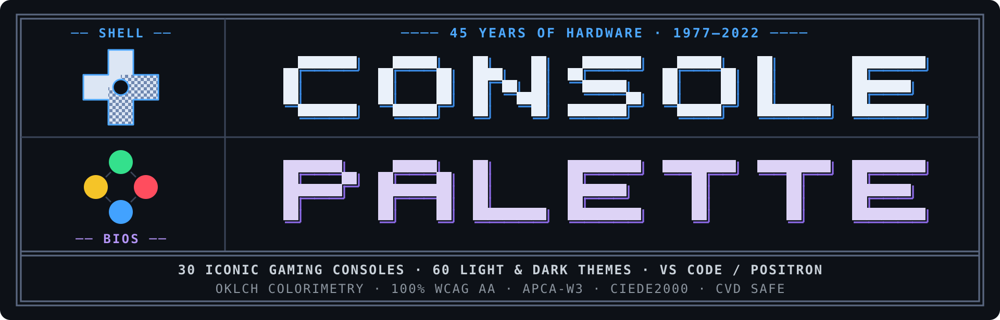
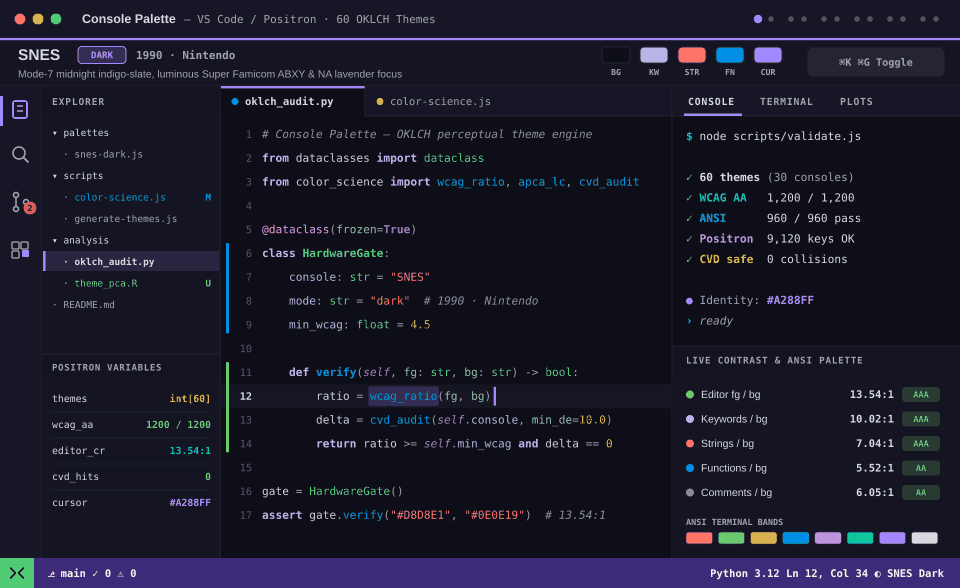
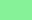
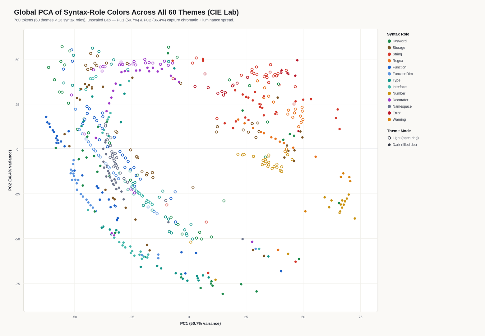
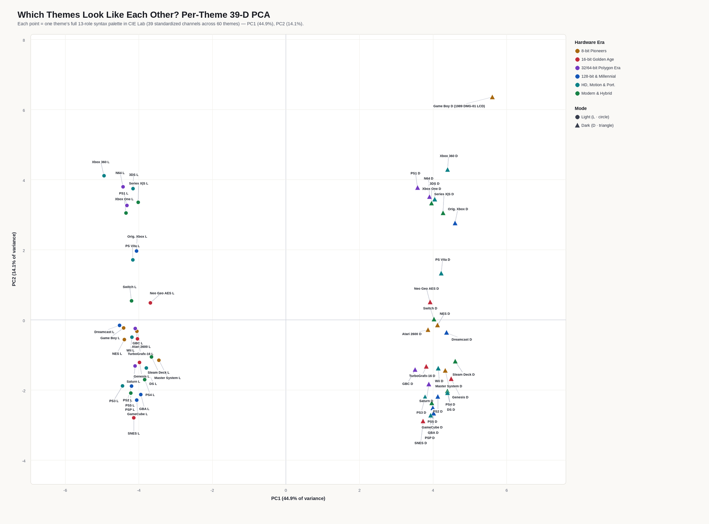
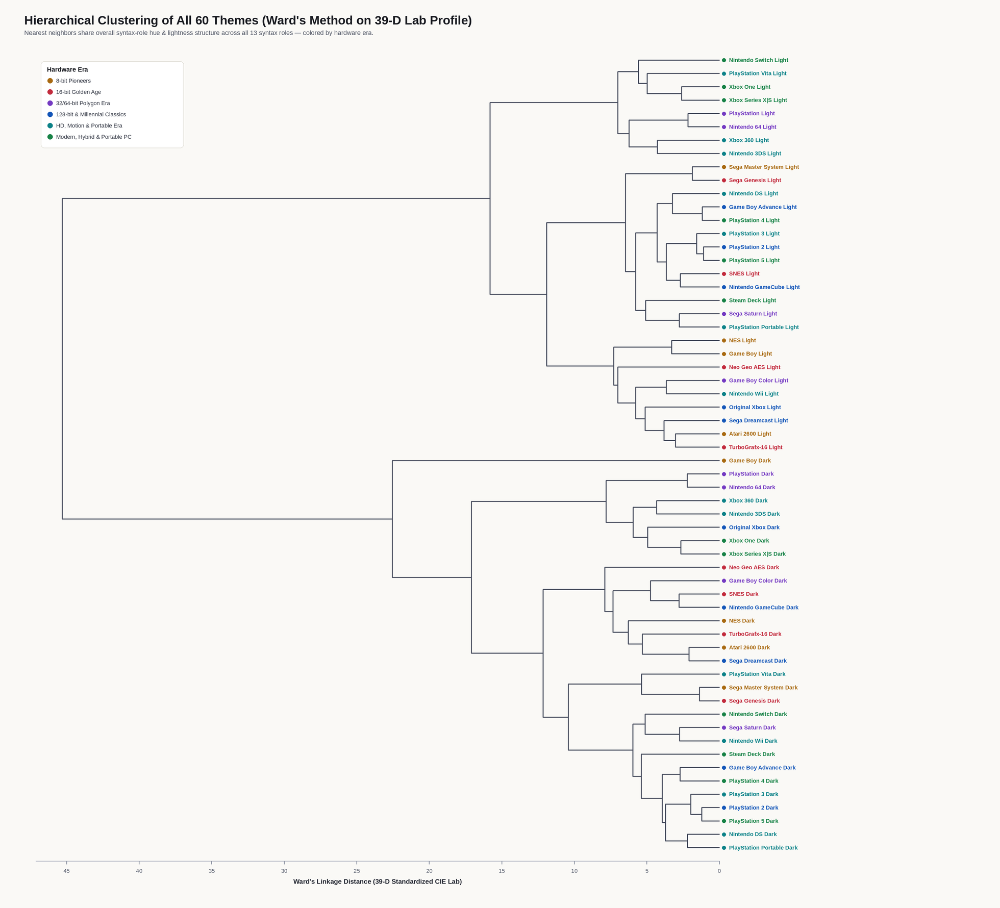

<!-- markdownlint-disable MD033 MD041 -->
<div align="center">

<picture>
  <source media="(prefers-color-scheme: dark)" srcset="assets/banner/banner-dark.png">
  <source media="(prefers-color-scheme: light)" srcset="assets/banner/banner-light.png">
  
</picture>

# Console Palette

**A Light and Dark color theme for every iconic gaming console.**
30 consoles · 60 themes · one VS Code / Positron extension.

*An independent tribute to 45 years of gaming console industrial design, controller color craft, and display hardware (1977–2022).*


[](https://idesofmerge.github.io/console-palette/)
[](https://github.com/idesofmerge/console-palette/actions/workflows/build.yml)


-2A5F25?style=flat-square)


**[Launch the Live Interactive Workbench & Colorimetry Explorer ↗](https://idesofmerge.github.io/console-palette/)**
*(Or run **`Console Palette: Open Palette & Colorimetry Explorer`** directly inside VS Code / Positron!)*

<br>



</div>

---

Every pair in **Console Palette** is individually authored from its machine's authentic outer plastic shell, controller face buttons, LED indicators, boot/BIOS screen, and display hardware — never a generic syntax template reskinned onto a new background:

- **PlayStation (PS1)** maps syntax roles directly to the iconic DualShock geometric quartet — Triangle Emerald, Circle Coral, Cross Cobalt, and Square Rose — anchored by the unmistakable amber-orange startup BIOS diamond.
- **SNES** unites both regional legends in one pair: North American warm grey-lavender shell & violet switches alongside the Japanese/PAL Super Famicom four-color ABXY palette.
- **TurboGrafx-16** flips across the Pacific on Light ↔ Dark toggle: crisp ivory Japanese **PC Engine** with vermilion HuCard accents in Light mode, and stealth charcoal-black North American **TurboGrafx-16** with blazing tangerine lettering in Dark mode.
- **Game Boy Dark** honors the 1989 DMG-01's iconic 4-shade reflective olive-green STN LCD (`#0F380F`–`#9BBC0F`) with a perceptually monotonic OKLCH lightness ramp that still clears WCAG AA across every role, keeping only the glowing left-bezel battery LED for errors.
- **Sega Dreamcast**, **Original Xbox**, **Nintendo Switch**, and **Steam Deck** anchor their entire syntax envelopes to each console's unmistakable hardware signature — orange swirl & VMU seafoam, radioactive flubber emerald, Neon Blue & Neon Red Joy-Cons, and OLED flame-orange & Steam steel-blue.

Every palette is synthesized and verified in **OKLCH** perceptual color space against **WCAG 2.1**, **APCA-W3**, **CIEDE2000** (ΔE₀₀), and **Machado et al. (2009)** dichromacy simulation. Design inspiration comes strictly from **industrial color language and hardware atmosphere** — no console logos, trademarks, sprites, or copyrighted assets are included or referenced anywhere in this repository.

## The 30 consoles, by launch year

<picture>
  <source media="(prefers-color-scheme: dark)" srcset="assets/diagrams/release-timeline-dark.png">
  <source media="(prefers-color-scheme: light)" srcset="assets/diagrams/release-timeline-light.png">
  
</picture>

## ...and by hardware lineage

Organized as a transit metro map across manufacturer lines — showing how **Nintendo Home** (NES → Wii) and **Nintendo Handheld** (Game Boy → 3DS) physically converge into the hybrid **Nintendo Switch**, how **PlayStation** branches into **PSP → PS Vita**, and how **Sega**, **Xbox**, **Arcade Pioneers**, and **Steam Deck** trace 45 years of hardware evolution:


```sh
python3 scripts/generate-color-science-assets.py  # or: Rscript --vanilla analysis/timeline_metro.R
```

## Every pair tells a hardware story

Four examples of how a Light/Dark pair is built — anchored to each console's real plastic finish, controller buttons, and display lighting while maintaining strict perceptual contrast and OKLCH lightness separation:

### SNES (1990) — warm grey-lavender shell & Super Famicom 4-color ABXY

| Role | Light | Dark |
|---|---|---|
| Background |  `#E9E9F2` classic warm grey-lavender shell |  `#0E0E19` Mode-7 midnight indigo-slate |
| Keywords |  `#4D35A9` North American concave violet |  `#BAB3FF` luminous SNES lavender |
| Strings |  `#AC0D27` Super Famicom Red A button |  `#FF7059` CRT coral-ruby A button |
| Functions |  `#004783` Super Famicom Blue X button |  `#008FE4` luminous Super Famicom azure |
| Types |  `#006F30` Super Famicom Green Y button |  `#50CA73` crisp Mode-7 emerald Y button |
| **Identity accent** |  `#6247B8` **SNES switch violet** |  `#A288FF` glowing violet focus |

### PlayStation (1994) — iconic PS1 grey, amber boot diamond & △ ○ × □ quartet

| Role | Light | Dark |
|---|---|---|
| Background |  `#E5E7EA` unmistakable 1994 PlayStation grey |  `#0B0E16` black-bottomed CD & BIOS void |
| Keywords |  `#00603A` **△ Triangle** emerald green |  `#36D38B` luminous Triangle emerald |
| Strings |  `#AF1B3E` **○ Circle** coral crimson |  `#FF836E` glowing Circle coral |
| Functions |  `#003471` **× Cross** cobalt blue |  `#188AF1` electric Cross sapphire |
| Types |  `#8C256A` **□ Square** rose-magenta |  `#F67DC8` neon Square rose pink |
| **Identity accent** |  `#DE6A16` **Sony boot diamond orange** |  `#F58426` glowing BIOS startup amber |

### Sega Dreamcast (1998) — frost-white shell, orange spiral swirl & VMU teal

| Role | Light | Dark |
|---|---|---|
| Background |  `#EEF2F7` 9/9/99 frost-white casing |  `#0B1013` Sega Sports Black edition |
| Keywords |  `#6F2A00` burnt Dreamcast swirl orange |  `#FF9464` glowing spiral swirl tangerine |
| Strings |  `#A81939` controller crimson B accent |  `#FF767F` arcade coral-crimson |
| Functions |  `#002853` Sega / PAL swirl cobalt blue |  `#35A8FF` luminous GD-ROM sky blue |
| Types |  `#006657` VMU screen deep seafoam-teal |  `#02E7C3` backlit VMU seafoam-cyan |
| **Identity accent** |  `#E05212` **Dreamcast swirl orange** |  `#FF6B1E` radiant swirl beacon |

### Nintendo Switch (2017) — OLED White / Basic Black UI & Neon Joy-Con duotone

| Role | Light | Dark |
|---|---|---|
| Background |  `#F0F3F6` Switch OLED White / Basic White UI |  `#0F1216` Switch Basic Black Home UI |
| Keywords |  `#00713C` Splatoon / eShop emerald |  `#64EE93` luminous Joy-Con lime-emerald |
| Strings |  `#C92035` **Neon Red Joy-Con** crimson |  `#FF7F89` glowing Neon Coral-Red Joy-Con |
| Functions |  `#003C4D` **Neon Blue Joy-Con** deep cyan |  `#0099B6` luminous Neon Cyan-Blue Joy-Con |
| Types |  `#1D44A3` docked cobalt-indigo |  `#8BAAFF` crisp Home-grid periwinkle |
| **Identity accent** |  `#E60012` **Nintendo Switch Red** |  `#FF4554` radiant Neon Red cursor |

## The full catalog

<details>
<summary><strong>All 60 themes across 30 iconic consoles, era by era — click to expand</strong></summary>

Each swatch strip reads left to right: **background · keywords · strings · functions · types**. Every single theme has unique primary hexes — zero copy-pasted syntax templates across consoles.

<!-- CATALOG:START -->
**8-bit Pioneers (1977–1989)**

| Console | Light (bg · keyword · string · function · type) | Dark (bg · keyword · string · function · type) |
|---|---|---|
| **Atari 2600** (1977 · Atari) |      |      |
| **NES** (1985 · Nintendo) |      |      |
| **Sega Master System** (1985 · Sega) |      |      |
| **Game Boy** (1989 · Nintendo) |      |      |

**16-bit Golden Age (1987–1990)**

| Console | Light (bg · keyword · string · function · type) | Dark (bg · keyword · string · function · type) |
|---|---|---|
| **TurboGrafx-16** (1987 · NEC / Hudson) |      |      |
| **Sega Genesis** (1988 · Sega) |      |      |
| **SNES** (1990 · Nintendo) |      |      |
| **Neo Geo AES** (1990 · SNK) |      |      |

**32/64-bit Polygon Era (1994–1998)**

| Console | Light (bg · keyword · string · function · type) | Dark (bg · keyword · string · function · type) |
|---|---|---|
| **Sega Saturn** (1994 · Sega) |      |      |
| **PlayStation** (1994 · Sony) |      |      |
| **Nintendo 64** (1996 · Nintendo) |      |      |
| **Game Boy Color** (1998 · Nintendo) |      |      |

**128-bit & Millennial Classics (1998–2001)**

| Console | Light (bg · keyword · string · function · type) | Dark (bg · keyword · string · function · type) |
|---|---|---|
| **Sega Dreamcast** (1998 · Sega) |      |      |
| **PlayStation 2** (2000 · Sony) |      |      |
| **Game Boy Advance** (2001 · Nintendo) |      |      |
| **Nintendo GameCube** (2001 · Nintendo) |      |      |
| **Original Xbox** (2001 · Microsoft) |      |      |

**HD, Motion & Portable Era (2004–2011)**

| Console | Light (bg · keyword · string · function · type) | Dark (bg · keyword · string · function · type) |
|---|---|---|
| **Nintendo DS** (2004 · Nintendo) |      |      |
| **PlayStation Portable** (2004 · Sony) |      |      |
| **Xbox 360** (2005 · Microsoft) |      |      |
| **Nintendo Wii** (2006 · Nintendo) |      |      |
| **PlayStation 3** (2006 · Sony) |      |      |
| **Nintendo 3DS** (2011 · Nintendo) |      |      |
| **PlayStation Vita** (2011 · Sony) |      |      |

**Modern, Hybrid & Portable PC (2013–2022)**

| Console | Light (bg · keyword · string · function · type) | Dark (bg · keyword · string · function · type) |
|---|---|---|
| **PlayStation 4** (2013 · Sony) |      |      |
| **Xbox One** (2013 · Microsoft) |      |      |
| **Nintendo Switch** (2017 · Nintendo) |      |      |
| **PlayStation 5** (2020 · Sony) |      |      |
| **Xbox Series X\|S** (2020 · Microsoft) |      |      |
| **Steam Deck** (2022 · Valve) |      |      |
<!-- CATALOG:END -->

*(Swatch PNGs are generated locally by `scripts/generate-swatches.js` — no third-party badge service, no network dependency for viewers, nothing to go stale.)*

</details>

## Installing from the Marketplace or Open VSX

Search for **Console Palette** in the Extensions view (`Ctrl+Shift+X` / `Cmd+Shift+X`) in VS Code, Positron, or any VS Code-compatible editor, or install from the command line:

```sh
code --install-extension idesofmerge.console-palette
# or in Positron:
positron --install-extension idesofmerge.console-palette
```

## Packaging & installing locally

From this repository root:

```sh
npx --yes @vscode/vsce package
code --install-extension console-palette-1.0.0.vsix
# or in Positron:
positron --install-extension console-palette-1.0.0.vsix
```

Or launch an Extension Development Host without packaging:

```sh
code --extensionDevelopmentPath="<full path to this folder>"
# or: positron --extensionDevelopmentPath="<full path to this folder>"
```

## Selecting & previewing themes

- **Console Palette: Open Palette & Colorimetry Explorer** (Command Palette or Welcome walkthrough): opens a 100% offline interactive workbench & colorimetry studio directly inside VS Code / Positron — preview R, Python, TypeScript, and Quarto/SQL buffers across all 60 themes, inspect live OKLCH / WCAG 2.1 / APCA readouts and OKLab chromaticity polygons, simulate Protanopia / Deuteranopia / Tritanopia in real time, and click **Apply to Workbench** (or toggle **Live-sync IDE**) to switch your editor theme on the fly. The exact same explorer is also hosted on the web via **[GitHub Pages](https://idesofmerge.github.io/console-palette/)**.
- **Console Palette: Pick Console Theme** (Command Palette or click the active theme badge in the bottom-right status bar): opens a release-ordered quick-pick grouped by all 30 consoles (with launch year & maker) with **live theme preview** as you arrow up/down, hardware subtitle notes on every entry, an `Active` indicator on your current theme, and clean `Esc` rollback if you cancel.
- **Preferences: Color Theme** (`Ctrl+K Ctrl+T` / `Cmd+K Cmd+T`): standard alphabetical VS Code / Positron picker across all 60 themes.
- **Console Palette: Random Theme**: jumps to a random theme across the other 59 themes — great for touring the catalog.
- **Welcome: Open Walkthrough** → **Welcome to Console Palette**: interactive first-run walkthrough covering theme picking, per-console Light/Dark toggling, hardware identity accents, and launching the interactive Explorer.

## Smart Light ↔ Dark per-console toggle

Run **Console Palette: Toggle Theme** from the Command Palette or press `Ctrl+K Ctrl+G` (`Cmd+K Cmd+G` on macOS). Unlike a generic light/dark switch, it flips between the Light and Dark variant of **whichever console you're currently using** (e.g. *PlayStation Light* ↔ *PlayStation Dark*, *Steam Deck Light* ↔ *Steam Deck Dark*, *Game Boy Light* ↔ *Game Boy Dark*). If a non-Console Palette theme is active, it starts on *SNES Light*. Only the standard `workbench.colorTheme` User setting is read or written.

## How the themes are built

<picture>
  <source media="(prefers-color-scheme: dark)" srcset="assets/diagrams/build-pipeline-dark.png">
  <source media="(prefers-color-scheme: light)" srcset="assets/diagrams/build-pipeline-light.png">
  
</picture>

Hand-authoring ~350 workbench, TextMate, semantic-token, and Positron IDE keys across 60 themes doesn't scale by hand, so `scripts/generate-themes.js` expands each console's ~45-token hardware palette (`palettes/*.js`) using OKLCH perceptual mixing, `scripts/generate-explorer.js` compiles the self-contained GitHub Pages (`site/index.html`) and VS Code Webview (`assets/explorer/explorer.html`) interactive explorers from those same modules, and `scripts/validate.js` enforces multi-gate colorimetric and zero-CDN CSP verification on every build:

```sh
node scripts/generate-themes.js          # regenerate themes/*.json + package.json + theme-metadata.json
node scripts/generate-explorer.js        # regenerate site/index.html + assets/explorer/explorer.html
node scripts/generate-swatches.js        # regenerate 538 local swatch PNGs in assets/swatches/
python3 scripts/generate-icon.py         # regenerate 4x supersampled 3D-beveled Light/Dark gamepad icon
python3 scripts/generate-banner.py       # regenerate Dark/Light 2x Retina README banners
python3 scripts/generate-diagrams.py     # regenerate Dark/Light 2x Retina timeline & pipeline diagrams
python3 scripts/generate-showcase-gif.py # regenerate animated VS Code / Positron IDE showcase GIF
node scripts/validate.js                 # audit all 60 themes, Explorer CSP & Positron key provenance
```

## Accessibility & perceptual contrast

Every single theme must clear strict automated perceptual gates before `generate-themes.js` or `validate.js` will succeed:

- **100% WCAG 2.1 AA compliance (`1,200 / 1,200` foreground & syntax tokens)**: all 20 foreground/syntax tokens in all 60 themes clear **≥ 4.5:1** on `editor.background` (actual range across the family: **`4.61:1` to `15.84:1`**) and **≥ 3.8:1** on `editor.lineHighlightBackground`.
- **APCA-W3 spatial contrast**: primary body text (`fg` on `bg`) achieves **`|Lc| = 82.8` to `98.2`** (`13.27:1`–`15.84:1` WCAG) across all 59 polychromatic themes, tuned to avoid OLED halation in Dark mode while keeping Light plastic-shell surfaces glare-free and crisp.
- **Figure–ground hierarchy**: comments (`fgComment`) clear AA comfortably (`4.77:1`–`6.52:1`) while remaining perceptually subordinate to active code tokens so documentation never competes with control flow.
- **960 / 960 ANSI terminal tokens verified**: all 16 ANSI colors in every integrated terminal / Positron console clear contrast gates while preserving canonical terminal hue bands (so red errors stay red and green diffs stay green regardless of a console's keyword accent).

| Representative Theme | Editor `fg` / `bg` (WCAG) | Editor `fg` / `bg` (`|Lc|` APCA) | Comment / `bg` | Tightest foreground/syntax role / `bg` |
|---|---|---|---|---|
| **Nintendo Switch Light** | `15.55:1` | `96.8` | `6.38:1` | `5.04:1` |
| **Sega Dreamcast Light** | `15.40:1` | `96.2` | `6.34:1` | `5.76:1` |
| **SNES Light** | `14.34:1` | `91.6` | `5.91:1` | `5.25:1` |
| **Original Xbox Dark** | `13.68:1` | `83.2` | `6.11:1` | `4.87:1` |
| **PlayStation Dark** | `13.66:1` | `83.2` | `6.06:1` | `4.86:1` |
| **Steam Deck Dark** | `13.66:1` | `83.2` | `6.10:1` | `4.86:1` |
| **Game Boy Dark** *(1989 DMG-01 LCD ramp)* | `8.83:1` | `74.8` | `4.77:1` | `4.61:1` |

## Color science

Every theme's 13 adjacent syntax-relevant roles (`keyword`, `storage`, `string`, `regex`, `function`, `function-dim`, `type`, `interface`, `number`, `decorator`, `namespace`, `error`, `warning` — **780 syntax tokens** across 60 themes) are synthesized in Björn Ottosson's **OKLCH** perceptual color space and audited in **CIE 1976 `L*a*b*`** (`CIEDE2000` ΔE₀₀ for normal-vision categorical distinctness and **Machado, Oliveira & Fernandes (2009)** physiological cone-matrix simulation for protanopia, deuteranopia, and tritanopia).


Plotting each theme's 10 core syntax roles in the CIE `a*`–`b*` chromaticity plane and connecting them in fixed role order reveals each console's chromatic signature at a glance: *Game Boy Dark* collapses into a tight olive-chartreuse needle near a single hue angle (authentic 1989 DMG-01 LCD), while every other console spans a wide, balanced polygon tailored to its specific hardware accent architecture.




An unscaled global PCA across all **780 syntax tokens** (`PC1 = 50.7%`, `PC2 = 36.4%`, explaining **87.1%** of total perceptual variance in 2D) shows how semantic roles occupy structured, well-separated regions while giving consoles expressive cross-hue freedom where hardware identity calls for violet keywords (SNES/GameCube), orange keywords (Dreamcast/Atari), emerald keywords (Xbox/PS1/Switch), or sapphire keywords (PS2/PS4/PS5/Genesis).

### Which console themes look like each other

Converting each theme's 13 syntax roles into a **39-dimensional CIE `L*a*b*` feature vector** (`analysis/theme_similarity.R`) lets us compare entire themes side-by-side via standardized PCA (`PC1 = 44.9%`, `PC2 = 14.1%`) and **Ward's minimum-variance hierarchical clustering**:





Three empirical patterns emerge directly from the geometry without any manual grouping:

1. **Clean polarity separation + 1989 DMG-01 hardware isolation**: All 30 Light themes and 30 Dark themes split cleanly along `PC1`, while **Game Boy Dark** branches off completely alone at the top of the Dark supercluster (and sits isolated in the upper-right of `PC1`–`PC2`), quantitatively confirming its unique 1989 DMG-01 olive LCD ramp.
2. **Manufacturer color DNA clusters automatically**: **PlayStation 2, 3, 4, and 5** form a consecutive four-generation PlayStation block in *both* Light and Dark modes; **Original Xbox, Xbox One, and Xbox Series X\|S** cluster directly together in Dark mode; and **Sega Master System + Sega Genesis** pair up cleanly in both modes from their shared Sega cobalt-and-crimson DNA.
3. **Cross-generation industrial kin pair as nearest neighbors**: **SNES** and **Nintendo GameCube** pair directly together in *both* Light and Dark modes (Nintendo's signature lavender-indigo heritage), while warm amber/tangerine hardware icons (**Atari 2600**, **TurboGrafx-16**, and **Sega Dreamcast**) group naturally from color coordinates alone.

### Color-vision-deficiency (CVD) resilience via OKLCH lightness staggering

Categorical syntax palettes that rely purely on hue (such as an isoluminant red string next to a green keyword) collapse under protanopia or deuteranopia. To prevent this scientifically, every Console Palette theme staggers adjacent syntax roles across **OKLCH perceptual lightness (`L`)** as well as hue — because luminance contrast survives all three cone deficiencies even when chromatic axes collapse.


Across all **4,680 role-pairs** (`60 themes × 78 pairs`) and **1,260 critical adjacent syntax pairs** (`keyword`, `storage`, `string`, `function`, `type`, `number`, `error`):

- **59 polychromatic themes (`1,239` critical pairs)**: **0 severe collisions** (`< 5 ΔE*ab`) and **0 moderate collisions** (`< 10 ΔE*ab`) under simulated protanopia, deuteranopia, or tritanopia. Every critical syntax pair stays `≥ 10.40 ΔE*ab` apart across all three CVD simulations.
- **Game Boy Dark (monochrome hardware tribute)**: accounts for the only **3** critical pairs below `10 ΔE*ab` in the entire 60-theme family (`accentStorage`/`colorError` at `2.46`, `accentKeyword`/`accentType` at `7.63`, and `accentKeyword`/`accentStorage` at `9.67`), preserved intentionally as a documented, faithful tribute to the 1989 Game Boy's single-hue olive LCD ramp while still clearing WCAG AA (`4.61:1`–`8.83:1`) on every token.

```sh
node scripts/export-color-data.js                  # export 900 token rows (Lab + OKLCH + WCAG + APCA) to analysis/data/colors.csv
python3 scripts/generate-color-science-assets.py   # regenerate all high-DPI PNG plots + audit CSVs + metro map
# Pure-R analytical scripts are also included:
Rscript --vanilla analysis/color_science.R
Rscript --vanilla analysis/theme_similarity.R
Rscript --vanilla analysis/timeline_metro.R
```

## Notes

- An independent, unofficial tribute to gaming hardware industrial design — not affiliated with or endorsed by Atari, Nintendo, Sega, NEC, SNK, Sony, Microsoft, or Valve.
- Zero runtime `npm` dependencies — `extension.js` uses only the built-in `vscode` API and static `theme-metadata.json`.
- Positron-specific workbench tokens (`positronConsole.*`, `positronVariables.*`, `positronPlots.*`, `positronDataExplorer.*`, etc.) are strictly validated against Positron's upstream color registry (`9,120` verified usages across 60 themes).
- No console logos, trademarks, sprites, or copyrighted assets appear anywhere in this repository — every visual (extension icon, README banners, animated IDE showcase GIF, 538 swatch PNGs, timeline & architecture diagrams, Hardware Lineage Metro Map, and color-science plots) is generated algorithmically from hex coordinates and geometric primitives.

## License

MIT — see [LICENSE](LICENSE).
