<!-- markdownlint-disable MD033 MD041 -->
<div align="center">

<picture>
  <source media="(prefers-color-scheme: dark)" srcset="assets/banner/banner-dark.png">
  <source media="(prefers-color-scheme: light)" srcset="assets/banner/banner-light.png">
  
</picture>

# Console Palette

**A Light and Dark color theme for every iconic gaming console.**
39 consoles · 78 themes · one VS Code / Positron extension.

*An independent tribute to 49 years of gaming console industrial design, controller color craft, and display hardware (1977–2026).*


[](https://idesofmerge.github.io/console-palette/)
[](https://github.com/idesofmerge/console-palette/actions/workflows/build.yml)


-2A5F25?style=flat-square)


**[Launch the Live Interactive Workbench & Colorimetry Explorer ↗](https://idesofmerge.github.io/console-palette/)**
*(Or run **`Console Palette: Open Palette & Colorimetry Explorer`** directly inside VS Code / Positron!)*

<br>


</div>

---

Every pair in **Console Palette** is individually authored from its machine's authentic outer plastic shell, controller face buttons, LED indicators, boot/BIOS screen, and display hardware — never a generic syntax template reskinned onto a new background:

- **Atari 2600**, **Atari Lynx**, and **Atari Jaguar** anchor the full Atari lineage — from 1977 Heavy Sixer oiled walnut and cartridge rainbow bands to 1989 backlit color LCD cyan/orange and 1993 Tempest 2000 electric violet & Jaguar Claw crimson.
- **PlayStation (PS1)** maps syntax roles directly to the iconic DualShock geometric quartet — Triangle Emerald, Circle Coral, Cross Cobalt, and Square Rose — anchored by the unmistakable amber-orange startup BIOS diamond.
- **SNES** unites both regional legends in one pair: North American neutral-cool grey shell & violet switches alongside the Japanese/PAL Super Famicom four-color ABXY palette.
- **Game Boy Dark** & **Virtual Boy Dark** honor Nintendo's most iconic display experiments — the 1989 DMG-01's 4-shade olive STN LCD (`#0F380F`–`#9BBC0F`) with a perceptually monotonic OKLCH ramp, and the 1995 pitch-black stereoscopic visor illuminated by blazing 650nm crimson LEDs.
- **Playdate**, **Nintendo Switch 2**, **ROG Xbox Ally**, **Steam Machine**, and **Steam Frame** carry the craft all the way through **2026** — canary yellow & 1-bit Sharp Memory LCD ink, magnetic Joy-Con 2 Light Blue & Light Red rails, White/Black Ally emerald & ROG crimson, 6-inch cube walnut/red-fabric faceplates with 17-LED cyan-blue progress strips, and pancake-lens SteamVR teal with Half-Life Lambda amber.

Every palette is synthesized and verified in **OKLCH** perceptual color space against **WCAG 2.1**, **APCA-W3**, **CIEDE2000** (ΔE₀₀), and **Machado et al. (2009)** dichromacy simulation. Design inspiration comes strictly from **industrial color language and hardware atmosphere** — no console logos, trademarks, sprites, or copyrighted assets are included or referenced anywhere in this repository.

## The 39 consoles, by launch year

<picture>
  <source media="(prefers-color-scheme: dark)" srcset="assets/diagrams/release-timeline-dark.png">
  <source media="(prefers-color-scheme: light)" srcset="assets/diagrams/release-timeline-light.png">
  
</picture>

## ...and by hardware lineage

Organized as a transit metro map across manufacturer lines — solid lines trace main hardware generations across **Atari**, **Nintendo**, **Sega**, **PlayStation**, **Xbox**, **Valve / Steam**, and **Arcade / Indie** platforms, while dashed lines mark handheld, companion, and spatial branches (**Virtual Boy**, **PSP → PS Vita → PlayStation Portal**, **ROG Xbox Ally**, and **Steam Frame**), with **Nintendo Home** and **Nintendo Handheld** converging at **Nintendo Switch → Switch 2**:

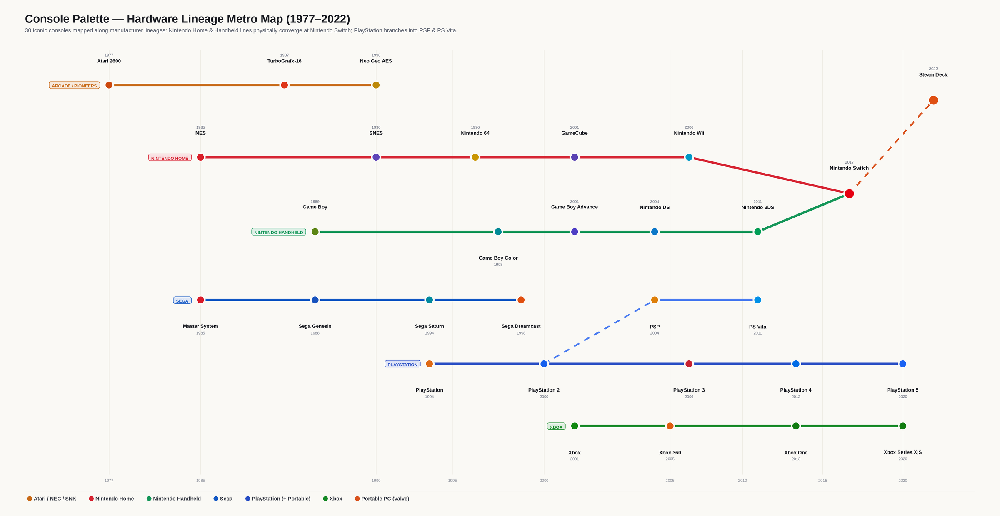

```sh
python3 scripts/generate-color-science-assets.py  # or: Rscript --vanilla analysis/timeline_metro.R
```

## Every pair tells a hardware story

Four examples of how a Light/Dark pair is built — anchored to each console's real plastic finish, controller buttons, and display lighting while maintaining strict perceptual contrast and OKLCH lightness separation:

### SNES (1990) — neutral-cool grey shell & Super Famicom 4-color ABXY

| Role | Light | Dark |
|---|---|---|
| Background | 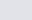 `#E2E3E8` classic SNES neutral-cool shell |  `#0F0F1A` Mode-7 midnight indigo-slate |
| Keywords |  `#5442BA` North American concave violet |  `#816DE2` luminous SNES lavender |
| Strings |  `#A1001F` Super Famicom Red A button |  `#F35051` CRT crimson-coral A button |
| Functions |  `#005092` Super Famicom Blue X button |  `#31A8FF` luminous Super Famicom azure |
| Types |  `#005F22` Super Famicom Green Y button |  `#35B35E` crisp Mode-7 emerald Y button |
| **Identity accent** |  `#5E44B8` **SNES switch violet** |  `#A288FF` glowing violet focus |

### PlayStation (1994) — iconic PS1 cement grey, amber boot diamond & △ ○ × □ quartet

| Role | Light | Dark |
|---|---|---|
| Background |  `#DDDFE2` unmistakable 1994 PlayStation grey |  `#111215` black-bottomed CD & BIOS void |
| Keywords |  `#006D42` **△ Triangle** emerald green |  `#1DCD83` luminous Triangle emerald |
| Strings |  `#9A001F` **○ Circle** coral crimson |  `#FF706D` glowing Circle coral |
| Functions |  `#003775` **× Cross** cobalt blue |  `#2291F8` electric Cross sapphire |
| Types |  `#6A004D` **□ Square** rose-magenta |  `#F87CC9` neon Square rose pink |
| **Identity accent** |  `#DE6A16` **Sony boot diamond orange** |  `#F58426` glowing BIOS startup amber |

### Sega Dreamcast (1998) — frost-white shell, fiery orange swirl & VMU teal

| Role | Light | Dark |
|---|---|---|
| Background |  `#F2F5F8` 9/9/99 frost-white casing |  `#0E1214` Sega Sports Black edition |
| Keywords |  `#B14500` fiery Dreamcast swirl orange |  `#FF8F62` glowing spiral swirl tangerine |
| Strings |  `#AC0D37` controller crimson B accent |  `#FF6B77` arcade coral-crimson |
| Functions |  `#004E97` Sega / PAL swirl cobalt blue |  `#0087D8` luminous GD-ROM sky blue |
| Types |  `#006959` VMU screen deep seafoam-teal |  `#00BA9D` backlit VMU seafoam-cyan |
| **Identity accent** |  `#E04F0E` **Dreamcast swirl orange** |  `#FF6B1A` radiant swirl beacon |

### Nintendo Switch (2017) — OLED White / Basic Black UI & Neon Joy-Con duotone

| Role | Light | Dark |
|---|---|---|
| Background |  `#F3F5F6` Switch OLED White / Basic White UI | 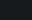 `#17191C` Switch Basic Black matte charcoal |
| Keywords |  `#007095` **Neon Blue Joy-Con** cyan-azure |  `#00A9CD` glowing **Neon Blue Joy-Con** |
| Strings |  `#BE0030` **Neon Red Joy-Con** crimson |  `#FD3E4E` blazing **Neon Red Joy-Con** |
| Functions |  `#2748AC` docked cobalt-indigo |  `#86ADFF` crisp Home-grid periwinkle |
| Types |  `#006531` Splatoon / eShop emerald |  `#30C46C` luminous Splatoon lime-emerald |
| **Identity accent** |  `#E60012` **Nintendo Switch Red** |  `#FF3E4D` radiant Neon Red cursor |

## The full catalog

<details>
<summary><strong>All 78 themes across 39 iconic consoles, era by era — click to expand</strong></summary>

Each swatch strip reads left to right: **background · keywords · strings · functions · types**. Every single theme has unique primary hexes — zero copy-pasted syntax templates across consoles.

<!-- CATALOG:START -->
**8-bit Pioneers (1977–1989)**

| Console | Light (bg · keyword · string · function · type) | Dark (bg · keyword · string · function · type) |
|---|---|---|
| **Atari 2600** (1977 · Atari) |      |      |
| **NES** (1985 · Nintendo) |      |      |
| **Sega Master System** (1985 · Sega) |      |      |
| **Game Boy** (1989 · Nintendo) |      |      |
| **Atari Lynx** (1989 · Atari) |      |     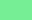 |

**16-bit Golden Age (1987–1990)**

| Console | Light (bg · keyword · string · function · type) | Dark (bg · keyword · string · function · type) |
|---|---|---|
| **TurboGrafx-16** (1987 · NEC / Hudson) |      |      |
| **Sega Genesis** (1988 · Sega) |      |      |
| **SNES** (1990 · Nintendo) |      |      |
| **Neo Geo AES** (1990 · SNK) |      |      |

**32/64-bit Polygon Era (1993–1998)**

| Console | Light (bg · keyword · string · function · type) | Dark (bg · keyword · string · function · type) |
|---|---|---|
| **Atari Jaguar** (1993 · Atari) |      |      |
| **Sega Saturn** (1994 · Sega) |      |      |
| **PlayStation** (1994 · Sony) |      |      |
| **Virtual Boy** (1995 · Nintendo) |      |      |
| **Nintendo 64** (1996 · Nintendo) |      |      |
| **Game Boy Color** (1998 · Nintendo) | 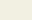     |      |

**128-bit & Millennial Classics (1998–2001)**

| Console | Light (bg · keyword · string · function · type) | Dark (bg · keyword · string · function · type) |
|---|---|---|
| **Sega Dreamcast** (1998 · Sega) |      |      |
| **PlayStation 2** (2000 · Sony) |      |      |
| **Game Boy Advance** (2001 · Nintendo) |      |      |
| **Nintendo GameCube** (2001 · Nintendo) |      |      |
| **Xbox** (2001 · Microsoft) |      |      |

**HD, Motion & Portable Era (2004–2011)**

| Console | Light (bg · keyword · string · function · type) | Dark (bg · keyword · string · function · type) |
|---|---|---|
| **Nintendo DS** (2004 · Nintendo) |      |      |
| **PlayStation Portable** (2004 · Sony) | 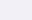     |      |
| **Xbox 360** (2005 · Microsoft) |      |      |
| **Nintendo Wii** (2006 · Nintendo) |      |      |
| **PlayStation 3** (2006 · Sony) |      |      |
| **Nintendo 3DS** (2011 · Nintendo) |      |      |
| **PlayStation Vita** (2011 · Sony) |      |      |

**Modern, Hybrid & Portable PC (2013–2022)**

| Console | Light (bg · keyword · string · function · type) | Dark (bg · keyword · string · function · type) |
|---|---|---|
| **PlayStation 4** (2013 · Sony) |      |      |
| **Xbox One** (2013 · Microsoft) |      |      |
| **Nintendo Switch** (2017 · Nintendo) |      |      |
| **PlayStation 5** (2020 · Sony) |      |      |
| **Xbox Series X\|S** (2020 · Microsoft) |      |      |
| **Steam Deck** (2022 · Valve) |      |      |
| **Playdate** (2022 · Panic) |      |      |

**Next-Gen & Spatial Era (2023–2026)**

| Console | Light (bg · keyword · string · function · type) | Dark (bg · keyword · string · function · type) |
|---|---|---|
| **PlayStation Portal** (2023 · Sony) |      |      |
| **Nintendo Switch 2** (2025 · Nintendo) |      |      |
| **ROG Xbox Ally** (2025 · Microsoft / ASUS) |      |      |
| **Steam Machine** (2026 · Valve) |      |      |
| **Steam Frame** (2026 · Valve) |      |      |
<!-- CATALOG:END -->

*(Swatch PNGs are generated locally by `scripts/generate-swatches.js` — no third-party badge service, no network dependency for viewers, nothing to go stale.)*

</details>

## Installing from the Marketplace or Open VSX

Search for **Console Palette** in the Extensions view (`Ctrl+Shift+X` / `Cmd+Shift+X`) in VS Code, Positron, or any VS Code-compatible editor, or install from the command line:

```sh
code --install-extension idesofmerge.console-palette
# or in Positron:
positron --install-extension idesofmerge.console-palette
```

## Packaging & installing locally

From this repository root:

```sh
npx --yes @vscode/vsce package
code --install-extension console-palette-1.1.0.vsix
# or in Positron:
positron --install-extension console-palette-1.1.0.vsix
```

Or launch an Extension Development Host without packaging:

```sh
code --extensionDevelopmentPath="<full path to this folder>"
# or: positron --extensionDevelopmentPath="<full path to this folder>"
```

## Selecting & previewing themes

- **Console Palette: Open Palette & Colorimetry Explorer** (Command Palette or Welcome walkthrough): opens a 100% offline interactive workbench & colorimetry studio directly inside VS Code / Positron — filter all 39 consoles by name, maker (`All · Atari · Nintendo · Sony · Sega · Microsoft · Valve · Arcade & Indie`), year, or era (`/`), open the **Interactive Perceptual Similarity Map** (`M`) to explore all themes in 2D CIEDE2000 MDS space with live `ΔE₀₀` distance inspection, hop directly between **Nearest Chromatic Neighbors** chips, launch **Side-by-Side Compare** (`C`) with dual OKLab chromaticity polygons, preview R / Python / TypeScript / Quarto+SQL buffers, simulate Protanopia / Deuteranopia / Tritanopia in real time, export palettes for **VS Code**, **Ghostty**, **WezTerm**, **Alacritty**, or **CSS variables**, copy stateful shareable links, and click **Apply to Workbench** (or toggle **Live-sync IDE**) to switch your editor theme on the fly. The exact same explorer is also hosted on the web via **[GitHub Pages](https://idesofmerge.github.io/console-palette/)**.
- **Console Palette: Pick Console Theme** (Command Palette or click the active theme badge in the bottom-right status bar): opens a release-ordered quick-pick grouped by all 39 consoles (searchable by console name, maker, launch year, or era) with **live theme preview** as you arrow up/down, hardware subtitle notes on every entry, an `Active` indicator on your current theme, and clean `Esc` rollback if you cancel.
- **Preferences: Color Theme** (`Ctrl+K Ctrl+T` / `Cmd+K Cmd+T`): standard alphabetical VS Code / Positron picker across all 78 themes.
- **Console Palette: Random Theme** & **Random Theme (Same Mode)**: jump to a random theme across the catalog, or stay locked to your current Light or Dark polarity.
- **Console Palette: Sync Current Console with OS Light/Dark**: binds your active console's Light & Dark pair to `workbench.preferredLightColorTheme` and `workbench.preferredDarkColorTheme` and enables `window.autoDetectColorScheme` in one click.
- **Status Bar Badge Setting** (`consolePalette.showStatusBarItem`): configure the bottom-right theme badge to show `"always"`, `"whenActive"` (only when a Console Palette theme is selected), or `"never"`.
- **Welcome: Open Walkthrough** → **Welcome to Console Palette**: interactive first-run walkthrough covering theme picking, per-console Light/Dark toggling, hardware identity accents, and launching the interactive Explorer.

## Smart Light ↔ Dark per-console toggle

Run **Console Palette: Toggle Theme** from the Command Palette or press `Ctrl+K Ctrl+G` (`Cmd+K Cmd+G` on macOS). Unlike a generic light/dark switch, it flips between the Light and Dark variant of **whichever console you're currently using** (e.g. *PlayStation Light* ↔ *PlayStation Dark*, *Nintendo Switch 2 Light* ↔ *Nintendo Switch 2 Dark*, *Steam Machine Light* ↔ *Steam Machine Dark*, *Game Boy Light* ↔ *Game Boy Dark*). If a non-Console Palette theme is active, it starts on *SNES Light*. Only the standard `workbench.colorTheme` User setting is read or written.

## How the themes are built

<picture>
  <source media="(prefers-color-scheme: dark)" srcset="assets/diagrams/build-pipeline-dark.png">
  <source media="(prefers-color-scheme: light)" srcset="assets/diagrams/build-pipeline-light.png">
  
</picture>

Hand-authoring ~400 workbench, Command Center, AI Chat/Inline Chat, Test Explorer, Terminal Sticky Scroll, TextMate, semantic-token, and Positron IDE keys across 78 themes doesn't scale by hand, so `scripts/generate-themes.js` expands each console's ~45-token hardware palette (`palettes/*.js`) using OKLCH perceptual mixing, `scripts/generate-explorer.js` compiles the self-contained GitHub Pages (`site/index.html`) and VS Code Webview (`assets/explorer/explorer.html`) interactive explorers from those same modules, and `scripts/validate.js` + `test/*.test.js` enforce multi-gate colorimetric, zero-CDN CSP, and unit-test verification on every build (see [CONTRIBUTING.md](CONTRIBUTING.md) for details):

```sh
npm run build                            # regenerate themes/*.json, package.json, theme-metadata.json & Explorer bundles
npm run validate                         # audit all 78 themes, Explorer CSP & Positron key provenance
npm test                                 # run 43 zero-dependency unit tests (node --test test/*.test.js)
npm run swatches                         # regenerate 677 local swatch PNGs in assets/swatches/
npm run package                          # package lightweight .vsix (README-only media excluded)
python3 scripts/generate-icon.py         # regenerate 4x supersampled 3D-beveled Light/Dark gamepad icon
python3 scripts/generate-banner.py       # regenerate Dark/Light 2x Retina README banners
python3 scripts/generate-diagrams.py     # regenerate Dark/Light 2x Retina timeline & pipeline diagrams
python3 scripts/generate-showcase-gif.py # regenerate animated VS Code / Positron IDE showcase GIF
```

## Accessibility & perceptual contrast

Every single theme must clear strict automated perceptual gates before `generate-themes.js` or `validate.js` will succeed:

- **100% WCAG 2.1 AA compliance (`1,560 / 1,560` foreground & syntax tokens)**: all 20 foreground/syntax tokens in all 78 themes clear **≥ 4.5:1** on `editor.background` (actual range across the family: **`4.61:1` to `16.53:1`**) and **≥ 3.8:1** on `editor.lineHighlightBackground`.
- **APCA-W3 spatial contrast**: primary body text (`fg` on `bg`) achieves **`|Lc| = 83.2` to `99.8`** (`12.65:1`–`16.53:1` WCAG) across all 77 polychromatic themes, tuned to avoid OLED halation in Dark mode while keeping Light plastic-shell surfaces glare-free and crisp.
- **Figure–ground hierarchy**: comments (`fgComment`) clear AA comfortably (`4.77:1`–`6.96:1`) while remaining perceptually subordinate to active code tokens so documentation never competes with control flow.
- **1,248 / 1,248 ANSI terminal tokens verified**: all 16 ANSI colors in every integrated terminal / Positron console clear contrast gates while preserving canonical terminal hue bands (so red errors stay red and green diffs stay green regardless of a console's keyword accent).

| Representative Theme | Editor `fg` / `bg` (WCAG) | Editor `fg` / `bg` (`|Lc|` APCA) | Comment / `bg` | Tightest foreground/syntax role / `bg` |
|---|---|---|---|---|
| **Nintendo Switch Light** | `16.23:1` | `98.4` | `6.77:1` | `5.12:1` |
| **Sega Dreamcast Light** | `16.11:1` | `98.2` | `6.76:1` | `5.16:1` |
| **Nintendo Switch 2 Light** | `16.00:1` | `97.6` | `6.73:1` | `4.95:1` |
| **Playdate Light** | `15.84:1` | `96.7` | `6.65:1` | `5.04:1` |
| **Virtual Boy Dark** | `14.31:1` | `84.0` | `6.64:1` | `4.71:1` |
| **SNES Light** | `13.82:1` | `88.1` | `5.84:1` | `4.75:1` |
| **Nintendo 64 Light** | `13.57:1` | `86.9` | `5.66:1` | `4.72:1` |
| **Steam Machine Dark** | `13.57:1` | `84.2` | `6.28:1` | `5.09:1` |
| **Game Boy Dark** *(1989 DMG-01 LCD ramp)* | `8.83:1` | `74.8` | `4.77:1` | `4.61:1` |

## Color science

Every theme's 13 adjacent syntax-relevant roles (`keyword`, `storage`, `string`, `regex`, `function`, `function-dim`, `type`, `interface`, `number`, `decorator`, `namespace`, `error`, `warning` — **1,014 syntax tokens** across 78 themes) are synthesized in Björn Ottosson's **OKLCH** perceptual color space and audited in **CIE 1976 `L*a*b*`** (`CIEDE2000` ΔE₀₀ for normal-vision categorical distinctness and **Machado, Oliveira & Fernandes (2009)** physiological cone-matrix simulation for protanopia, deuteranopia, and tritanopia).

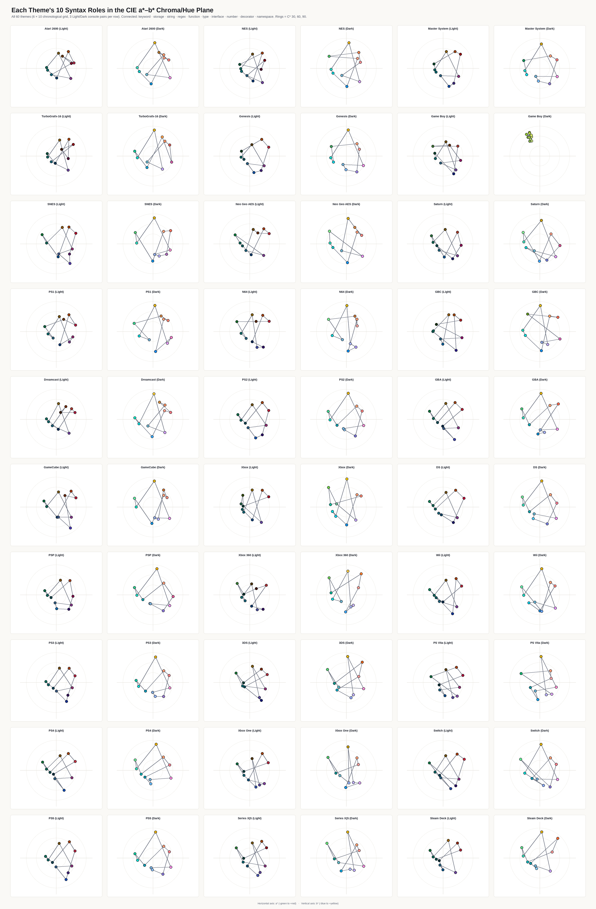

Plotting each theme's 10 core syntax roles in the CIE `a*`–`b*` chromaticity plane and connecting them in fixed role order reveals each console's chromatic signature at a glance: *Game Boy Dark* collapses into a tight olive-chartreuse needle near a single hue angle (authentic 1989 DMG-01 LCD), while every other console spans a wide, balanced polygon tailored to its specific hardware accent architecture.

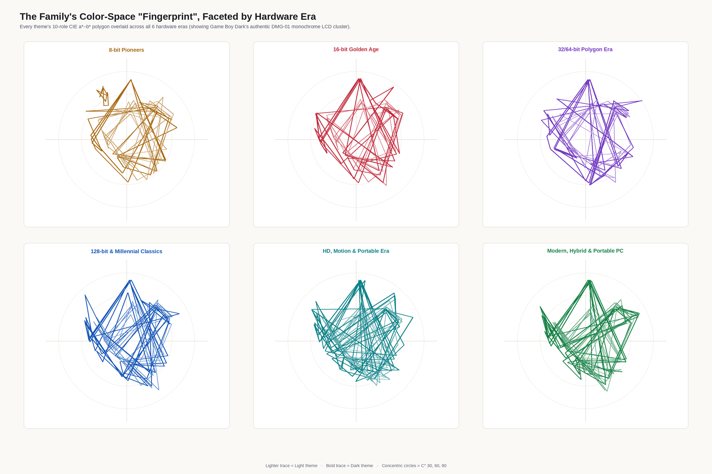


An unscaled global PCA across all **1,014 syntax tokens** (`PC1 = 50.7%`, `PC2 = 39.6%`, explaining **90.3%** of total perceptual variance in 2D) shows how semantic roles occupy structured, well-separated regions while giving consoles expressive cross-hue freedom where hardware identity calls for violet keywords (SNES/GameCube/PSP/Atari Jaguar), orange/gold keywords (Dreamcast/Atari 2600/Playdate), emerald keywords (Xbox/PS1/N64/ROG Xbox Ally), or sapphire/cyan keywords (PS2/PS4/PS5/PS Portal/Switch/Switch 2/Steam Machine).

### Which console themes look like each other

Measuring mean **CIEDE2000 (`ΔE₀₀`)** distance across all 13 syntax roles between every pair of consoles — factored by Light and Dark polarity so luminance never masks chromatic identity — maps the entire family into a 2D **Classical MDS perceptual landscape** (`52.3%` of Light distance variance, `54.8%` of polychromatic Dark distance variance; `analysis/data/theme-mds.csv`), a **Ward-ordered 39×39 split-triangle distance matrix**, and a full **78-theme Ward's hierarchical dendrogram**:

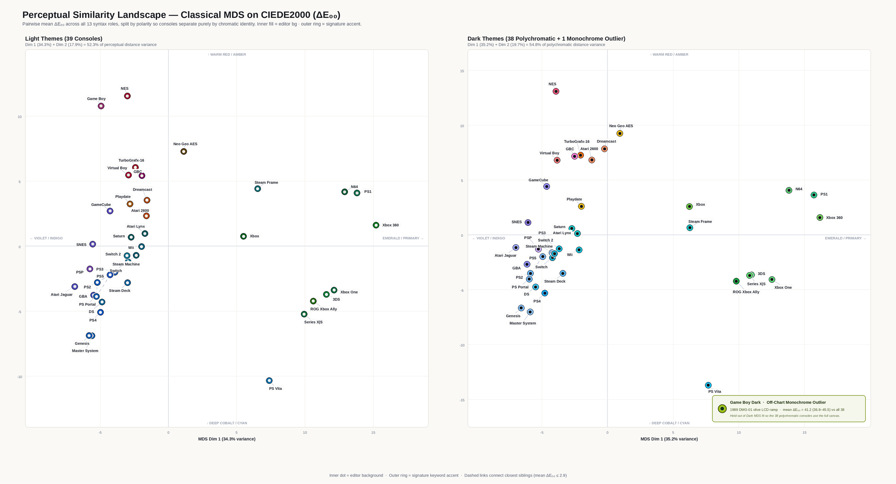

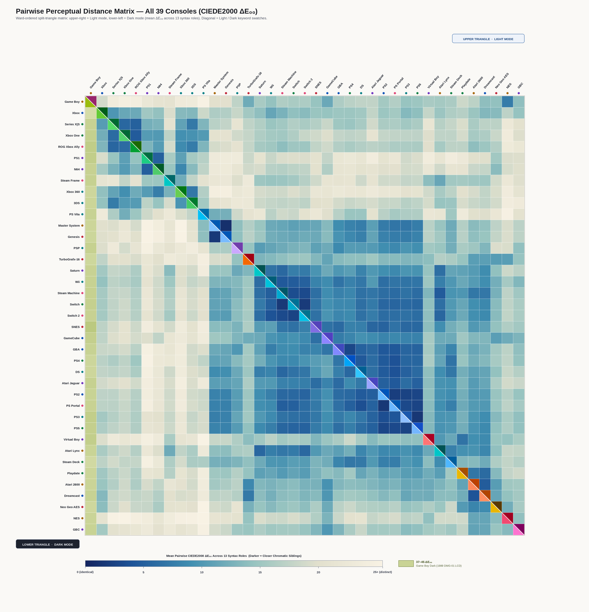


Three empirical patterns emerge directly from the geometry without any manual grouping:

1. **Mirror-symmetric Light & Dark chromatic topography + DMG-01 isolation**: Orienting Light and Dark MDS along the same semantic poles reveals nearly identical hardware neighborhoods in both modes — **Indigo/Violet** on the left (*Atari Jaguar*, *SNES*, *GameCube*, *PSP*), **Emerald/Primary** on the right (*Xbox 360*, *PS1*, *N64*, *Xbox One*, *3DS*), **Warm Red/Amber** at the top (*NES*, *Neo Geo AES*, *TurboGrafx-16*, *Dreamcast*, *Virtual Boy*), and **Deep Cobalt/Cyan** at the bottom (*PS Vita*, *Master System*, *Genesis*, *PS4*) — while **Game Boy Dark** sits cleanly off-chart at **mean `41.2 ΔE₀₀`** (`36.8–45.5`) from every polychromatic Dark theme, quantifying its faithful 1989 DMG-01 olive LCD ramp.
2. **Manufacturer color DNA forms unmistakable diagonal blocks**: **Sega Master System ↔ Sega Genesis** (`0.97` Light / `1.76` Dark `ΔE₀₀`), **PlayStation 2 / PlayStation Portal / PlayStation 3 / PlayStation 5** (`1.60–2.83 ΔE₀₀`), **Nintendo Switch ↔ Nintendo Switch 2** (`1.92` Light / `2.59` Dark `ΔE₀₀`), and **Xbox / Xbox One / Xbox Series X\|S / ROG Xbox Ally** cluster automatically as tight dark-indigo blocks along the distance matrix diagonal.
3. **Cross-generation industrial kin pair as nearest neighbors**: **SNES** and **Nintendo GameCube** pair directly in *both* Light and Dark modes (Nintendo's lavender-indigo heritage), **PlayStation (PS1)** and **Nintendo 64** pair in *both* modes (1994–1996 neutral-grey/charcoal shells with primary button quartets), **Steam Machine Dark** lands beside **Nintendo Switch Dark** (`1.82 ΔE₀₀` — matte black + electric cyan & crimson), and fiery orange hardware icons (**Atari 2600** and **Sega Dreamcast**) pair directly from color coordinates alone.

### Color-vision-deficiency (CVD) resilience via OKLCH lightness staggering

Categorical syntax palettes that rely purely on hue (such as an isoluminant red string next to a green keyword) collapse under protanopia or deuteranopia. To prevent this scientifically, every Console Palette theme staggers adjacent syntax roles across **OKLCH perceptual lightness (`L`)** as well as hue — because luminance contrast survives all three cone deficiencies even when chromatic axes collapse.

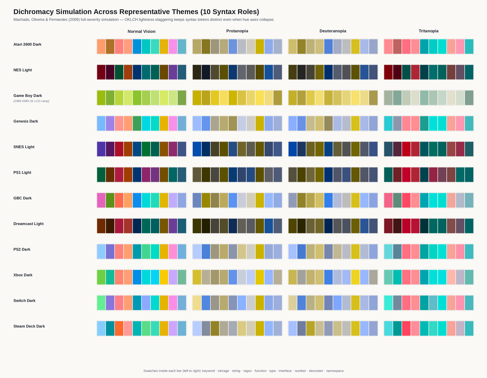

Across all **6,084 role-pairs** (`78 themes × 78 pairs`) and **1,638 critical adjacent syntax pairs** (`keyword`, `storage`, `string`, `function`, `type`, `number`, `error`):

- **77 polychromatic themes (`1,617` critical pairs)**: **0 severe collisions** (`< 5 ΔE*ab`) and **0 moderate collisions** (`< 10 ΔE*ab`) under simulated protanopia, deuteranopia, or tritanopia. Every critical syntax pair stays `≥ 10.37 ΔE*ab` apart across all three CVD simulations.
- **Game Boy Dark (monochrome hardware tribute)**: accounts for the only **3** critical pairs below `10 ΔE*ab` in the entire 78-theme family (`accentStorage`/`colorError` at `2.46`, `accentKeyword`/`accentType` at `7.63`, and `accentKeyword`/`accentStorage` at `9.67`), preserved intentionally as a documented, faithful tribute to the 1989 Game Boy's single-hue olive LCD ramp while still clearing WCAG AA (`4.61:1`–`8.83:1`) on every token.

```sh
node scripts/export-color-data.js                  # export 1,170 token rows (Lab + OKLCH + WCAG + APCA) to analysis/data/colors.csv
python3 scripts/generate-color-science-assets.py   # regenerate all high-DPI PNG plots + audit CSVs + metro map
# Pure-R analytical scripts are also included:
Rscript --vanilla analysis/color_science.R
Rscript --vanilla analysis/theme_similarity.R
Rscript --vanilla analysis/timeline_metro.R
```

## Notes

- An independent, unofficial tribute to gaming hardware industrial design — not affiliated with or endorsed by Atari, Nintendo, Sega, NEC, SNK, Sony, Microsoft, ASUS, Panic, or Valve.
- Zero runtime `npm` dependencies — `extension.js` uses only the built-in `vscode` API and static `theme-metadata.json`.
- Positron-specific workbench tokens (`positronConsole.*`, `positronVariables.*`, `positronPlots.*`, `positronDataExplorer.*`, etc.) are strictly validated against Positron's upstream color registry (`11,856` verified usages across 78 themes).
- No console logos, trademarks, sprites, or copyrighted assets appear anywhere in this repository — every visual (extension icon, README banners, animated IDE showcase GIF, 677 swatch PNGs, timeline & architecture diagrams, Hardware Lineage Metro Map, and color-science plots) is generated algorithmically from hex coordinates and geometric primitives.

## License

MIT — see [LICENSE](LICENSE).
